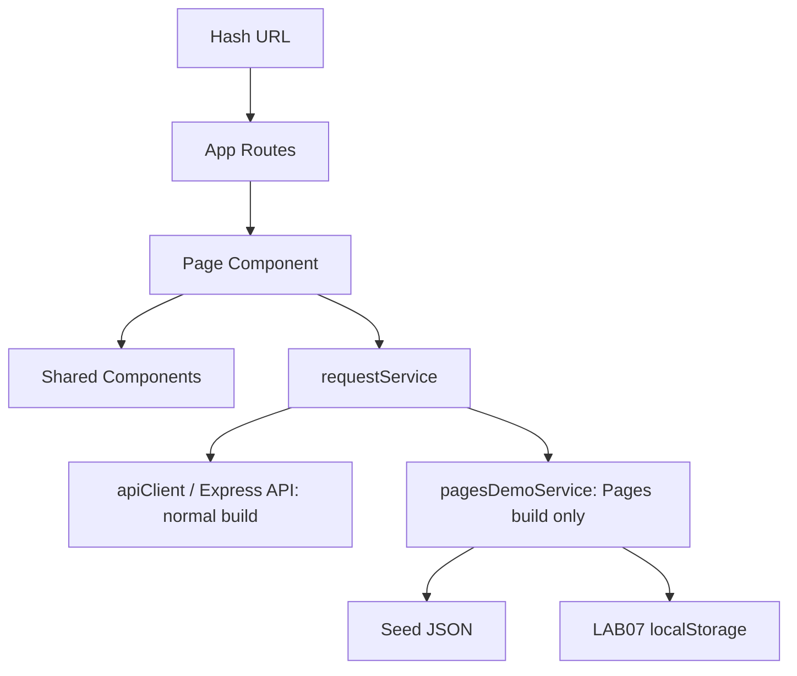

# ENGSE203 LAB07 — Campus Service Request

React frontend ของ LAB07 เชื่อม Express API ผ่าน apiClient

## Pages Demo

```sh
npm ci
npm run test:pages
npm run build:pages
npm run preview
```

`build:pages` เรียก Node script `scripts/build-pages.mjs` ซึ่งกำหนด public flag `VITE_PAGES_DEMO=true` แล้วเรียก Vite ใน mode pages จึงรันได้ทั้ง Windows และระบบอื่นโดยไม่ต้องมีไฟล์ environment หรือตั้ง environment ด้วย syntax ของ shell ใช้ไฟล์ใน `dist/` เป็นผลลัพธ์และคัดลอกไป `../../publish/` สำหรับ Pages

Pages Demo ใช้ seed เดียวกับ API 3 คำร้อง รองรับ filter, create, detail, status update, delete และ reset โดยบันทึกเฉพาะ LAB07 ใน localStorage key `engse203-week-07-pages-demo-v1` พร้อมป้ายอธิบายโหมดบน Dashboard การรัน `npm run dev` หรือ `npm run build` ปกติยังใช้ Express API ที่ `VITE_API_BASE_URL` หรือ `http://localhost:3001` ตามเดิม เปิด API ด้วย `npm start` จาก `../api/`

## Run

```bash
npm ci
npm run dev
npm run check
npm run build
npm run preview
```

## Architecture



- `App.jsx` กำหนด route matrix
- `pages/` เป็นเจ้าของ route-specific state และ lifecycle
- `components/` รับข้อมูลและ handler ผ่าน props
- `requestService.js` เป็น data-access boundary ของ UI
- `pagesDemoService.js` รับ storage adapter สำหรับโหมด Pages โดยไม่เปลี่ยน service contract ของ UI

## Effect reasoning

Dashboard Effect ขึ้นกับ `scenario` และ `reloadKey` เพราะทั้งสองค่าเปลี่ยนชุดข้อมูลที่ต้อง synchronize จาก Service ส่วน summary และ filtered list เป็น derived data ระหว่าง render จึงไม่อยู่ใน Effect มี `ignore` cleanup guard เพื่อป้องกันผล async เก่ามาเขียน state หลัง route/scenario เปลี่ยน

## Privacy

ใช้ข้อมูลสาธิตเท่านั้น ห้ามบันทึก token, password, secret หรือข้อมูลส่วนบุคคลจริงใน `localStorage` หรือหลักฐานภาพ
