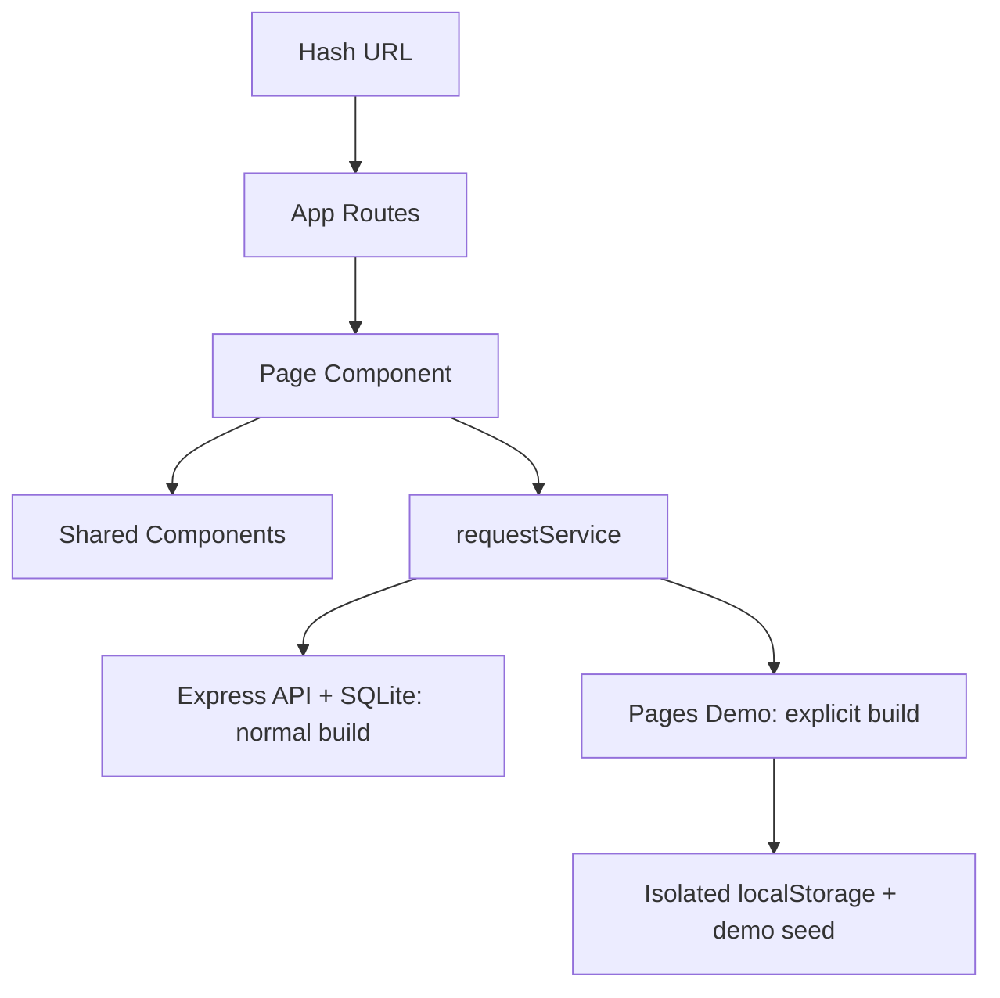

# ENGSE203 LAB10 — Campus Service Request

React frontend สำหรับ Express API + SQLite พร้อมโหมดสาธิตบน GitHub Pages

## Run

```bash
npm ci
npm run dev
npm run check
npm run build
npm run preview
```

โหมดปกติต้องเปิด API จาก `../api/` ด้วย ค่าเริ่มต้นคือ `http://localhost:3001` และเปลี่ยน backend ได้ด้วย `VITE_API_BASE_URL` โดย `npm run build` ยังคงสร้างแอปที่เชื่อม API ตามเดิม

## GitHub Pages demo

```bash
npm run test:pages
npm run build:pages
npm run preview
```

`build:pages` ตั้ง `VITE_PAGES_DEMO=true` เฉพาะ process ที่ build จากนั้น `requestService.js` จะเลือก `pagesDemoService.js` เพื่อจัดการข้อมูลตัวอย่างใน browser localStorage โหมดนี้ไม่มีการเรียก API หรือรัน SQLite บน Pages และแสดงคำอธิบายบน Dashboard, About และ footer

ข้อมูลเริ่มต้นมี 10 รายการ: pending 5, in-progress 3 และ completed 2 รองรับกรอง สร้าง ดูรายละเอียด เปลี่ยนสถานะ ลบ และ Reset Demo Data หลังยืนยัน โดยใช้คีย์ `engse203-week-10-pages-demo-v1` แยกจากแลบอื่น ข้อมูลเสียหายจะกู้จาก seed พร้อมแจ้งผู้ใช้ และแสดงข้อผิดพลาดเมื่อ browser storage ใช้งานไม่ได้

นำเฉพาะไฟล์ใน `dist/` ไปวางที่ `../../publish/` Node tests ใช้ storage mock ทดสอบ adapter ของ Pages เท่านั้น ไม่แทนผล checker ของ Express/SQLite API ที่ยังเป็น partial

## Architecture



- `App.jsx` กำหนด route matrix
- `pages/` เป็นเจ้าของ route-specific state และ lifecycle
- `components/` รับข้อมูลและ handler ผ่าน props
- `requestService.js` เป็น data-access boundary ของ UI
- `pagesDemoService.js` จัดการข้อมูลใน localStorage เฉพาะ Pages build

## Effect reasoning

Dashboard Effect ขึ้นกับ `scenario` และ `reloadKey` เพราะทั้งสองค่าเปลี่ยนชุดข้อมูลที่ต้อง synchronize จาก Service ส่วน summary และ filtered list เป็น derived data ระหว่าง render จึงไม่อยู่ใน Effect มี `ignore` cleanup guard เพื่อป้องกันผล async เก่ามาเขียน state หลัง route/scenario เปลี่ยน

## Privacy

ใช้ข้อมูลสาธิตเท่านั้น ห้ามบันทึก token, password, secret หรือข้อมูลส่วนบุคคลจริงใน `localStorage` หรือหลักฐานภาพ
